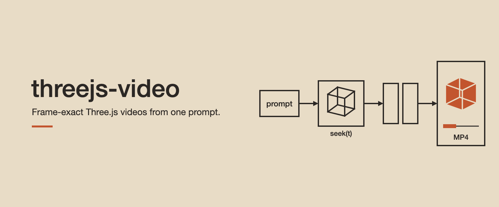

<p align="center">
  
</p>

<h1 align="center">threejs-video</h1>

<p align="center">
  An agent skill that turns "make a video with Three.js" into a frame-exact MP4, plus the benchmark and A/B test behind it.
</p>

<p align="center">
  <a href="#results"><b>Results</b></a> ·
  <a href="benchmark/RANKING.md">9-method benchmark</a> ·
  <a href="ab-test">A/B test</a> ·
  <a href="#install">Install</a>
</p>

<p align="center">
  
</p>

## Why

I benchmarked nine ways to have a coding agent add 3D and explainer graphics to a talking-head clip. The candidates were HyperFrames, Remotion, several published video skills, and plain Three.js with no skill at all. Plain Three.js placed third overall and used the fewest tokens of any method that drew its own graphics: 3.96M, against 10–17M for the framework skills.

Most of its time went into setup it would have to redo on every video. It wrote a renderer, worked out how to load a font for 3D text, built caption timing, and fought pixel formats. This skill packages those pieces once, so the agent's time goes into the idea and the look. I then tested whether that holds, with the same prompt sent to two fresh sessions, with and without the skill.

## Results

**A/B test**: one run each, fresh `claude -p` sessions, same prompt ([details](ab-test)):

| | No skill | With skill | Change |
|---|---|---|---|
| Wall time | 8 min 25 s | **3 min 04 s** | 2.7× faster |
| Turns | 27 | 16 | −41% |
| Tokens processed | 1.43M | **0.80M** | −44% |
| Output tokens | 32.6k | 17.0k | −48% |
| API cost | $1.46 | **$0.93** | −37% |

<p align="center">
  
</p>

Both videos met the spec. The run with the skill also chose a less generic look and a readable tagline, but the camera moved close enough to crop the word's edges for about two seconds.

**Benchmark**: nine methods on the same 43-second clip, scored /50 on creativity, word timing, pace, virality and professionalism ([full write-up](benchmark/RANKING.md)):

| Rank | Method | Score | Tokens processed | Active time |
|---|---|---|---|---|
| 1 | [script-skill](https://github.com/tenfoldmarc/script-skill) + neutral renderer | 41 | 3.76M | 9.3 min |
| 2 | [HyperFrames](https://github.com/heygen-com/hyperframes) | 41 | 13.94M | 26.2 min |
| 3 | Raw [Three.js](https://github.com/mrdoob/three.js) | 40 | 3.96M | 25.9 min |
| 4 | [Remotion skills](https://github.com/remotion-dev/skills) | 40 | 10.27M | 28.4 min |
| 5 | [explainroo](https://github.com/vincentsch/explainroo) | 37 | 11.31M | 15.3 min |
| 6 | [video-agent-skills](https://github.com/melvynx/video-agent-skills) | 37 | 17.12M | 13.0 min |
| 7 | [motionmaxxing](https://github.com/Tejashmakwana/motionmaxxing) | 34 | 11.18M | 15.7 min |
| 8 | [anatomy](https://github.com/wheresryan22/anatomy) (isometric) | 34 | 10.80M | 17.0 min |
| 9 | [attentionmachine-skills](https://github.com/robinebers/attentionmachine-skills) | 33 | 10.27M | 29.4 min |

"Active time" leaves out the minutes three agents spent waiting for the speaker cutout to finish.

## What I learned

- **Writing beat effects.** The winner was a scriptwriting skill on top of a plain renderer. A hook that pays off 40 seconds later, plus headlines that add meaning rather than repeat the speech, mattered more than any renderer feature.
- **Two methods were far cheaper than the rest.** Raw Three.js and script-skill each processed under 4M tokens. All seven others processed 10–17M.
- **The agents kept fighting the same problems.** The fixes now sit in the skill's Gotchas list:
  - npm `three` ships no 3D-text fonts;
  - JPEG frames turn into `yuvj420p`, which some players reject;
  - a new headless Chrome build failed to launch;
  - esbuild hung under `~/Downloads`;
  - symlinked assets returned 404;
  - canvas textures that change size render stale.
- **Most of a skill's value is the template.** In the A/B test, the run without the skill spent most of its turns writing a renderer. The run with the skill copied the template and wrote one scene file.
- **Stills don't catch everything.** The skill tells the agent to check stills at each beat, and the run with the skill still shipped two seconds of cropped type. The next fix is an automatic check that flags text leaving the safe area.

## What the skill gives an agent

- **Deterministic `seek(t)`.** Every frame is a pure function of time, so frames can render in parallel and stills match the video exactly. The skill spells out what breaks this rule: `requestAnimationFrame`, `Math.random`, and any state built up frame by frame.
- **A template with three layers:** a 3D world, a glow layer for selective bloom (solid objects can block the glow), and a UI layer that uses pixel coordinates.
- **Helpers:** easing, `tween`/`env`/`spring`, a seeded rng, and a cue timeline that finds words in Whisper output (`findCue`, `chunkWords`).
- **Text:** canvas text with accent markup, extruded 3D text from .ttf/.woff, and karaoke captions.
- **Motion and media:** camera paths, frame-exact image sequences, and a footage plate with a cut-out speaker.
- **`render.mjs`:** a headless-Chrome renderer with N workers. It renders slices into H.264 segments, joins them with a lossless concat, and muxes the audio. It can also export transparent ProRes 4444 with `--alpha`, and has `check` and `stills` modes for quick looks.
- **`qa.py`:** checks the specs, pixel format, loudness and black frames, and writes a contact sheet. It also writes a cue sheet showing each cue's frame and the frame 120 ms before it.
- **Recipes** for overlays on footage, kinetic type, data animation, beat sync and logo stings, plus notes on designing a look.

## Architecture

```mermaid
flowchart LR
    P[Prompt] --> S[new.sh<br/>scaffold template]
    S --> M[main.js<br/>seek&#40;t&#41; scenes + cues]
    M --> C[render.mjs check / stills]
    C -->|fix| M
    C --> R[render.mjs video]
    R --> W1[Chrome worker 1<br/>frames 0..n]
    R --> W2[Chrome worker N<br/>frames ..end]
    W1 --> F[ffmpeg concat<br/>+ audio mux]
    W2 --> F
    F --> Q[qa.py<br/>specs, contact + cue sheets]
    Q --> O[final.mp4]
```



**Each frame is a pure function of `t`, so rendering can run in parallel.** Each worker opens its own headless Chrome, seeks straight to its slice of frames, and pipes JPEGs to its own ffmpeg. The segments are joined with `-c copy`. In the A/B run, 300 frames at 1080×1920 rendered in 9.8 s on two workers.

**There's no bundler.** The template is plain ES modules with an importmap pointing at `node_modules`, served by a small static server inside `render.mjs`. In the benchmark, esbuild hung under `~/Downloads` and cost one agent a long detour.

**Every animation is tied to a cue.** Words come from Whisper, beats from audio onsets, and other moments from a hand-written table. `findCue(words, 'launch')` finds a word by its text, so a re-timed transcript still lines up.

**Stills come before the full render.** A still costs about a second and catches tiny text, collisions and empty frames before a full render. `qa.py`'s cue sheet then confirms that something meant to land on a word is visible at that word and not 120 ms earlier.

## Install

```sh
npx skills add albertyu647/threejs-video -g
```

Or copy `skills/threejs-video` into `~/.claude/skills/` (or your agent's skills folder). The renderer needs Node 18+, ffmpeg, Python 3, and a headless Chrome build:

```sh
npx @puppeteer/browsers install chrome-headless-shell@stable --path ~/.cache/puppeteer
```

Then ask your agent for a video:

```
Make a 10-second 9:16 video with Three.js: ... Use the threejs-video skill.
```

To use it by hand:

```sh
bash skills/threejs-video/scripts/new.sh my-video && cd my-video
# edit src/main.js
node render.mjs check
node render.mjs stills 0.5,2,4
node render.mjs video --out final.mp4
python3 qa.py final.mp4 --expect 1080x1920@30 --duration 6
```

Preview in a browser: `npx serve .`, then open `src/index.html?play`.

## Project structure

```
skills/threejs-video/
  SKILL.md              workflow, rules, gotchas, taste notes (what the agent reads)
  template/src/         main.js + lib/ (time, text, camera, post, media, plate)
  scripts/              new.sh, render.mjs, qa.py, extract_frames.sh
  references/           look.md, text.md, recipes/ (overlay, kinetic type, data, beat sync, logo sting)
ab-test/                run.sh, results, side-by-side preview, both videos, contact sheets
benchmark/RANKING.md    the 9-method benchmark: scores, reasoning, build cost
```

## Hardware

All runs were on a MacBook Pro with an Apple M3 (8 cores: 4 performance, 4 efficiency) and 16 GB of memory. Agents ran as Claude Code sessions on Claude Opus 5.5.

## Tech stack

[Three.js](https://github.com/mrdoob/three.js) 0.187, [Puppeteer](https://github.com/puppeteer/puppeteer) (puppeteer-core) with chrome-headless-shell, ffmpeg, [opentype.js](https://github.com/opentypejs/opentype.js), [Inter](https://github.com/rsms/inter) via Fontsource, and Python 3 for QA.

## Notes

MIT license. Not affiliated with any of the projects benchmarked. The benchmark's source clip, transcript and renders are not included. Related: [ai-3d-video-lessons](https://github.com/albertyu647/ai-3d-video-lessons).
