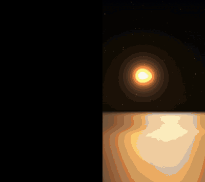

# A/B test: same prompt, with and without the skill

Two fresh Claude Code sessions (`claude -p`, Opus 5.5, no prior context) ran one after the other on the same machine. Each got this prompt:

> Make a 10-second video with Three.js: 1080x1920, 30fps, MP4. A 3D extruded word "ORBIT" is revealed with a camera move and glowing particles, ending on a tagline "Launching 2027". Save it as final.mp4 in this folder.

Run B got the same prompt with one sentence added: "Use the threejs-video skill."

The skill is installed globally, so run A could have found it on its own. To prevent that, [`run.sh`](run.sh) removed the skill's symlink for run A. It put the symlink back before run B, using an exit trap so the symlink comes back even if a run fails. The run logs confirm that A never loaded the skill and that B loaded it with its first tool call.

## Results

| | A: no skill | B: with skill | Change |
|---|---|---|---|
| Wall time | 8 min 25 s | **3 min 04 s** | 2.7× faster |
| Turns | 27 | 16 | −41% |
| Tokens processed (input + cache + output) | 1.43M | **0.80M** | −44% |
| Output tokens (including thinking) | 32.6k | 17.0k | −48% |
| API cost | $1.46 | **$0.93** | −37% |
| Tool calls | 24 (14 Bash, 8 Read, 2 Write) | 14 (9 Bash, 3 Read, 1 Write, 1 Skill) | −42% |
| Meets the spec (1080×1920, 30 fps, 10.0 s, H.264 yuv420p) | yes | yes | |

The numbers come from the `result` event at the end of each session's stream-json log.

Run A spent its extra turns building the infrastructure itself. It wrote its own renderer, installed opentype.js and worked out how to load a font for extruded 3D text. It also rendered single-process PNG frames and spent several rounds re-rendering stills to tune the glow. Run B scaffolded the template, wrote one scene file and checked stills. Its final 300 frames rendered in 9.8 s on two browser workers.

## The videos

  

Left is A (no skill) and right is B (with skill). The GIF is downscaled; the full-resolution MP4s (re-encoded smaller) are [`a-no-skill.mp4`](a-no-skill.mp4) and [`b-skill.mp4`](b-skill.mp4).

**A:** Particles stream in and form each letter, then peel off into an orbit ring while the camera swings around. The idea is good, but it uses the generic navy-and-blue tech look, and the "LAUNCHING 2027" tagline is thin and small enough that it's hard to read on a phone.

**B:** A comet streaks across the frame, each letter springs up as the comet passes it, and the comet's dust settles into a ring around the word. It's warm chrome on a reflective dark floor, and the tagline is large and readable. One real flaw: from about 2 to 4 s the camera is close enough that the word is wider than the frame, so its edges get cut off. The skill tells the agent to check stills before rendering, but this one slipped through.

Contact sheets: [A](contact-a-no-skill.jpg), [B](contact-b-skill.jpg).

## Caveats

This was one run each. A second run would give different numbers, but a 2.7× time gap and a 44% token gap are larger than the run-to-run spread I'd expect for a task like this. Judge the quality comparison for yourself; it's subjective.
